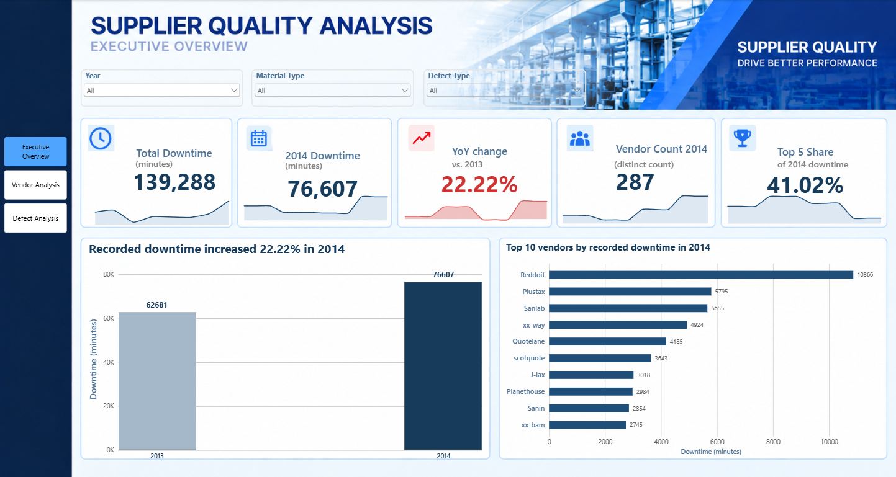
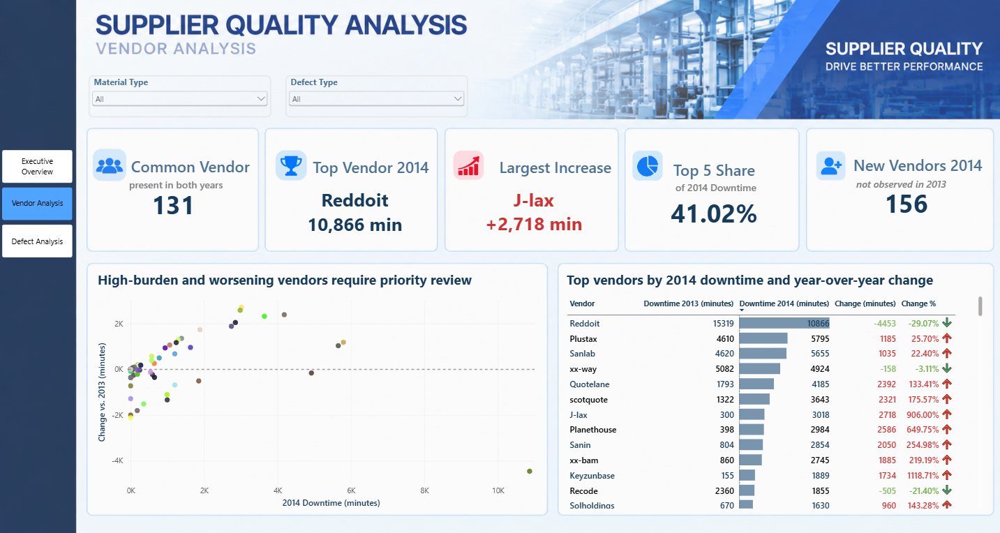
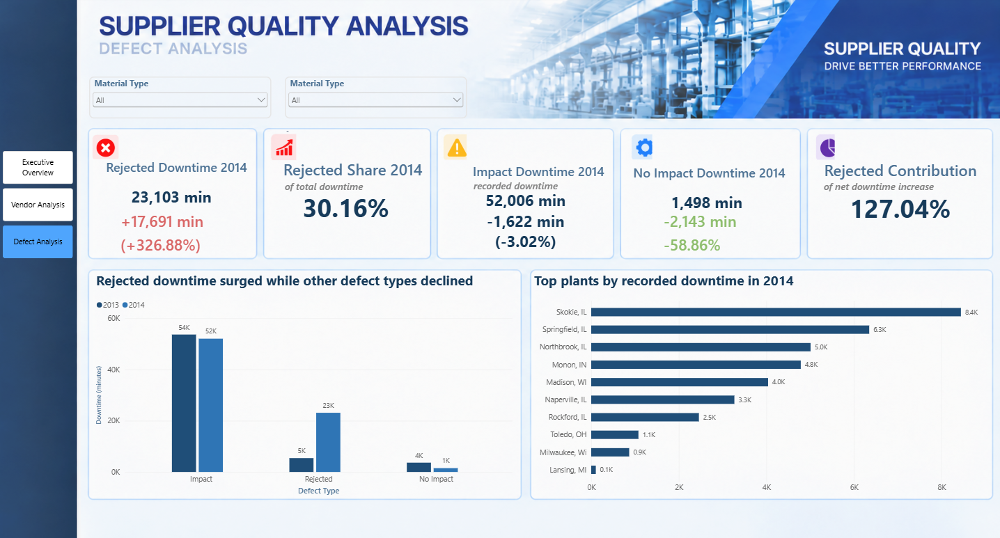

# Supplier Quality Power BI Analysis

## Project Overview

This project analyzes supplier quality performance using **Power BI, Python, and Excel** to identify which vendors should be prioritized for corrective-action review based on recorded production downtime.

The analysis uses the Microsoft / obviEnce **Supplier Quality Analysis** sample covering **2013–2014**.

The main analytical question is:

> Among vendors represented in the Supplier Quality Analysis dataset, how did total recorded production downtime change from 2013 to 2014, especially for vendors present in both years, and which vendors should be prioritized for corrective-action review?

The project combines:

- Data quality auditing
- Python exploratory analysis
- Like-for-like vendor comparison
- Vendor performance analysis
- Defect analysis
- Plant and material analysis
- Sensitivity testing
- Dimensional data modeling
- Power BI dashboard development
- Business recommendations

---

# Business Questions

The analysis was designed to answer the following questions:

- How did total recorded production downtime change from 2013 to 2014?
- How much of the change is explained by a different vendor population?
- What happens when only vendors present in both years are compared?
- Which vendors generated the highest downtime in 2014?
- Which continuing vendors deteriorated the most?
- Is downtime concentrated among a small number of suppliers?
- Which defect classifications drove the increase?
- Which plants and material types recorded the highest downtime?
- Do defect quantity and downtime produce the same vendor ranking?
- Are supplier rankings robust to extreme downtime observations?
- Which vendors should receive immediate corrective-action review?

---

# Dataset

The project uses the Microsoft Power BI **Supplier Quality Analysis** sample created by obviEnce using anonymized supplier-quality data.

The workbook used in this repository is:

```text
data/Supplier_Quality_PowerBI_Data.xlsx
```

## Dataset Summary

- **6,145 fact-table observations**
- **318 vendors**
- **24 manufacturing plants**
- Period: **1 January 2013 – 31 December 2014**
- Primary outcome: **Recorded production downtime (minutes)**
- Supporting outcome: **Defect quantity**

The analysis preserves the original fact-and-dimension structure of the workbook.

---

# Data Model

The source workbook follows a **Star Schema**.

## Fact Table

- `Metrics`

## Dimension Tables

- `Vendor`
- `Plant`
- `Date`
- `Defect`
- `Defect Type`
- `Material Type`
- `Category`

The model can be represented as:

```text
                     Date
                      │
                      │
Vendor ──────────── Metrics ──────────── Plant
                      │
                      │
                   Defect
                      │
                Defect Type
                      │
                Material Type
                      │
                   Category
```

The original dimensional structure was preserved in Power BI, while Python created a joined analytical dataframe only after data-quality checks were completed.

---

# Data Quality & Preparation

The Python workflow performs a structured audit before analysis.

Key preparation steps include:

- Loading the Excel fact and dimension sheets
- Converting Excel serial dates to datetime
- Validating dimension primary keys
- Checking missing values
- Checking negative numeric values
- Auditing exact duplicate observations
- Checking orphan foreign keys
- Performing many-to-one joins
- Confirming that joins preserve the original fact-table population
- Creating annual and vendor-level summaries
- Building like-for-like vendor comparisons
- Testing sensitivity to extreme downtime records

## Data Quality Findings

- Fact table: **6,145 observations × 10 original fields**
- Missing values in the main Metrics fields: **0**
- Negative `Defect Qty` values: **0**
- Negative `Downtime min` values: **0**
- Dimension-key duplicates: **0**
- Orphan foreign keys: **0**
- Rows after dimensional joins: **6,145**

### Exact Duplicate Observations

The audit identified:

- **193 exact duplicate observations beyond the first occurrence**
- **326 rows involved**
- **133 duplicate groups**

These observations were retained.

The dataset does not contain an event-level unique identifier, so identical rows cannot be confidently classified as erroneous duplicates rather than genuine repeated operational events.

---

# Analytical Method

The project uses descriptive and comparative analysis rather than predictive modeling.

The decision logic separates three signals.

## 1. Current Burden

Measured using:

```text
Total 2014 recorded downtime
```

This identifies where the largest operational interruption currently sits.

## 2. Deterioration

Measured using:

```text
2014 downtime − 2013 downtime
```

for vendors appearing in both years.

This identifies which continuing vendors worsened most.

## 3. Robustness

Vendor ranking is recalculated after excluding record-level downtime values above the **99th percentile**.

This tests whether a supplier's apparent poor performance is driven by a small number of extreme events.

---

# Dashboard Pages

The Power BI report contains three analytical pages.

---

## 1. Executive Overview

The Executive Overview provides a high-level view of supplier-quality performance.

Key metrics and analysis include:

- Total Downtime
- 2014 Downtime
- Downtime Change %
- Vendor Count
- Common Vendor Count
- Top 5 Vendor Downtime Share
- Year-over-Year Comparison
- Material Type Analysis
- Defect Type Analysis
- Vendor Concentration
- Year Filters
- Vendor Filters



---

## 2. Vendor Analysis

The Vendor Analysis page focuses on supplier-level operational burden and deterioration.

Key analyses include:

- 2013 Vendor Downtime
- 2014 Vendor Downtime
- Absolute Downtime Change
- Percentage Change
- Common Vendors
- New Vendors
- Highest-Downtime Vendors
- Largest Vendor Deterioration
- Like-for-Like Comparison
- Top Vendor Concentration
- Corrective-Action Prioritization



---

## 3. Defect Analysis

The Defect Analysis page focuses on operational drivers of downtime.

Key analyses include:

- Downtime by Defect Type
- Rejected Downtime
- Rejected Downtime Change
- Impact Downtime
- No Impact Downtime
- Plant-Level Downtime
- Material-Type Downtime
- Defect Classification Contribution
- Year-over-Year Defect Comparison



---

# Python Analysis

The reproducible analysis notebook is available at:

```text
notebooks/supplier_quality_analysis.ipynb
```

The notebook performs:

- Data loading
- Data auditing
- Date conversion
- Dimension validation
- Foreign-key validation
- Fact-dimension joins
- Annual downtime comparison
- Vendor coverage analysis
- Like-for-like vendor comparison
- Vendor ranking
- Vendor deterioration analysis
- Plant analysis
- Material analysis
- Defect-type analysis
- Defect quantity vs downtime comparison
- Outlier analysis
- Sensitivity testing
- Analytical chart generation

---

# Key Power BI Measures

The Power BI model includes measures for supplier-quality performance such as:

```text
Total Downtime
Downtime 2014
Downtime Change
Downtime Change %
Vendor Count
Vendor Count 2014
Common Vendor Count
Common Vendor Flag
New Vendors 2014
Top 5 Downtime Share 2014
Rejected Downtime
No Impact Change %
```

Additional measures are used for KPI displays and dashboard storytelling.

---

# Key Insights

## 1. Overall recorded downtime increased by 22.22%

Total recorded production downtime increased from:

- **2013: 62,681 minutes**
- **2014: 76,607 minutes**

Absolute increase:

**+13,926 minutes**

Percentage increase:

**+22.22%**

However, this headline number is affected by a large change in vendor coverage.

---

## 2. Vendor population changed substantially

The number of vendors represented in the dataset increased from:

- **162 vendors in 2013**
- **287 vendors in 2014**

Across both years:

- **318 vendors** appear in total
- **131 vendors** appear in both years
- **31 vendors** appear only in 2013
- **156 vendors** appear only in 2014

Therefore, comparing the raw annual totals alone would mix supplier performance changes with changes in supplier population.

---

## 3. Like-for-like downtime still increased by 13.82%

For the same **131 vendors** appearing in both years:

- 2013 downtime: **61,446 minutes**
- 2014 downtime: **69,939 minutes**

Increase:

**+8,493 minutes**

Percentage increase:

**+13.82%**

The like-for-like result is **8.40 percentage points lower** than the full-sample increase.

This indicates that vendor expansion explains part of the overall increase, but continuing suppliers also deteriorated.

---

## 4. Downtime was concentrated among a small number of vendors

The five highest-downtime vendors in 2014 were:

| Vendor | 2014 Downtime |
|---|---:|
| Reddoit | 10,866 min |
| Plustax | 5,795 min |
| Sanlab | 5,655 min |
| xx-way | 4,924 min |
| Quotelane | 4,185 min |

Together, these five suppliers accounted for approximately:

**41.02% of total 2014 downtime**

This concentration supports targeted supplier intervention rather than applying the same level of review to every vendor.

---

## 5. Current burden and deterioration are different signals

The supplier with the highest current downtime is not necessarily the supplier deteriorating most rapidly.

### Reddoit

Reddoit remained the highest-downtime vendor in 2014:

**10,866 minutes**

However, its performance improved from:

**15,319 minutes in 2013**

Change:

**−4,453 minutes (−29.07%)**

Reddoit therefore represents a high current burden, but not worsening performance.

---

## 6. Several continuing vendors deteriorated sharply

The largest increases among vendors appearing in both years were:

| Vendor | 2013 | 2014 | Change |
|---|---:|---:|---:|
| J-lax | 300 | 3,018 | +2,718 |
| Planethouse | 398 | 2,984 | +2,586 |
| Quotelane | 1,793 | 4,185 | +2,392 |
| scotquote | 1,322 | 3,643 | +2,321 |
| Sanin | 804 | 2,854 | +2,050 |

Percentage change is useful as supporting context, but absolute downtime change is more appropriate for corrective-action prioritization because percentage changes can become unstable when the previous-year baseline is very small.

---

## 7. Rejected records drove the overall deterioration

The increase in downtime was not broad across all defect classifications.

### Impact

- 2013: **53,628 minutes**
- 2014: **52,006 minutes**
- Change: **−3.02%**

### No Impact

- 2013: **3,641 minutes**
- 2014: **1,498 minutes**
- Change: **−58.86%**

### Rejected

- 2013: **5,412 minutes**
- 2014: **23,103 minutes**
- Increase: **+17,691 minutes**
- Percentage increase: **+326.88%**

The increase in `Rejected` downtime was larger than the net portfolio increase of 13,926 minutes.

Improvements in the other two categories therefore partially offset the deterioration in Rejected records.

---

## 8. Defect quantity and downtime identify different supplier risks

Defect quantity does not reproduce the downtime ranking.

Examples from 2014:

| Vendor | Downtime Rank | Defect Quantity Rank |
|---|---:|---:|
| Reddoit | 1 | 36 |
| Sanlab | 3 | 47 |
| scotquote | 6 | 56 |
| Quotelane | 5 | 1 |

This distinction is important.

`Defect Qty` measures recorded defective-material volume.

`Downtime min` measures production disruption.

Because the business decision in this project concerns operational interruption, downtime is used as the primary outcome.

---

## 9. Several plants recorded high operational burden

The largest plant-level downtime totals in 2014 included:

| Plant | Downtime |
|---|---:|
| Skokie, IL | 8,442 min |
| Bangor, MI | 8,401 min |
| Cincinnati OH | 8,338 min |
| Detriot, MI | 6,996 min |
| Springfield, IL | 6,348 min |

These plants provide practical drill-down locations for investigating high-burden suppliers.

---

## 10. Material type provides additional operational context

### Corrugate

- 2013: **26,728 minutes**
- 2014: **26,308 minutes**

Corrugate remained the highest-downtime material category but was broadly stable.

### Raw Materials

- 2013: **10,699 minutes**
- 2014: **13,229 minutes**

### Film

- 2013: **2,295 minutes**
- 2014: **6,473 minutes**

These results are descriptive rather than causal because the dataset does not contain supplier-volume or material-exposure denominators.

---

# Sensitivity Analysis

## Vendor Composition

Full-sample downtime increased:

**+22.22%**

Same-vendor downtime increased:

**+13.82%**

The **8.40 percentage-point difference** demonstrates that vendor population changes materially affect the headline result.

---

## Extreme Downtime Observations

The 99th percentile of record-level downtime is:

**360 minutes**

There are:

**59 observations above this threshold**

After removing observations above the 99th percentile:

- Reddoit remains rank 1
- Sanlab remains rank 3
- Quotelane remains rank 5
- scotquote remains rank 6

However, some suppliers are highly sensitive to extreme records.

### J-lax

Original ranking:

**7**

Ranking after excluding >P99 records:

**54**

2014 downtime falls from:

**3,018 minutes → 60 minutes**

Therefore, J-lax should be investigated as an **event-driven case** rather than immediately classified as a persistently poor supplier.

---

# Limitations

## 1. Changing Vendor Composition

Vendor count increased from 162 to 287.

The raw **+22.22%** increase therefore overstates like-for-like deterioration compared with the **+13.82%** increase among the same 131 suppliers.

---

## 2. No Exposure Denominator

The dataset does not provide:

- Units supplied by vendor
- Deliveries
- Purchase value
- Production volume

Therefore, total downtime measures **operational burden**, not a normalized supplier quality rate.

A high-volume supplier could naturally accumulate more downtime even if its downtime per unit supplied is relatively low.

---

## 3. Extreme-Event Sensitivity

Some vendor rankings are strongly affected by a small number of extreme observations.

J-lax is the clearest example.

Corrective action should therefore not be based solely on raw rankings without reviewing the underlying events.

---

## 4. Exact Duplicate Observations

The dataset contains **193 exact duplicate observations beyond the first occurrence**.

They were retained because no event-level identifier exists to determine whether the rows are:

- Genuine repeated stoppages
- Valid repeated quality events
- Accidental duplicate records

Automatically deleting them could remove legitimate events.

---

# Business Recommendations

The supplier-quality team should use a **tiered corrective-action review**, rather than ranking vendors using only one metric.

## Tier 1 — Immediate Corrective-Action Review

The strongest immediate candidates are:

### Quotelane

- 2014 downtime: **4,185 minutes**
- Change vs 2013: **+2,392 minutes**
- Ranking remained **5th** after P99 sensitivity analysis

### scotquote

- 2014 downtime: **3,643 minutes**
- Change: **+2,321 minutes**
- Ranking remained **6th** after sensitivity analysis

### Plustax

- 2014 downtime: **5,795 minutes**
- Change: **+1,185 minutes**
- Second-highest 2014 operational burden
- Remained in the top four after sensitivity testing

### Sanlab

- 2014 downtime: **5,655 minutes**
- Change: **+1,035 minutes**
- Third-highest 2014 burden
- Ranking remained stable after sensitivity testing

These suppliers combine relatively high current operational burden with deterioration and robust ranking.

---

## Tier 2 — Deteriorating Vendors Requiring Review

### Planethouse

- 2014 downtime: **2,984 minutes**
- Change: **+2,586 minutes**

### Sanin

- 2014 downtime: **2,854 minutes**
- Change: **+2,050 minutes**

Both show substantial deterioration and should receive additional supplier-quality review.

---

## Monitor Rather Than Automatically Escalate

### Reddoit

Reddoit remains the largest current burden, but its downtime improved by **29.07%** year over year.

It should remain under close monitoring rather than automatically being classified as deteriorating.

### xx-way

xx-way also has high current downtime but does not show the same deterioration pattern as the immediate-priority suppliers.

---

## Investigate J-lax Separately

J-lax recorded the largest raw increase among common vendors.

However, its ranking changes from:

**7 → 54**

when extreme downtime observations are removed.

The team should first determine whether the **999- and 960-minute records** represent:

- Distinct operational incidents
- Valid repeated stoppages
- A recording convention
- Data-quality issues

before escalating the supplier.

---

# Monitoring Plan

Supplier-quality review should become a recurring monitoring process.

Recommended metrics include:

### Total Downtime

Tracks overall operational burden.

### Common-Vendor Downtime

Separates supplier-performance changes from changes in vendor population.

### Rejected Downtime Share

Tracks the defect classification responsible for most of the 2014 increase.

### Top-Vendor Contribution

Measures whether downtime is becoming increasingly concentrated among a small group of suppliers.

### Exposure-Adjusted Downtime

If supplier-volume data becomes available, calculate:

```text
Downtime per unit supplied
```

or:

```text
Downtime per delivery
```

A vendor that remains high on both total downtime and exposure-adjusted downtime would provide stronger evidence for supplier-development action.

---

# Tools Used

- **Power BI**
- **Power Query**
- **DAX**
- **Python**
- **Pandas**
- **NumPy**
- **Matplotlib**
- **Excel**
- **Google Colab / Jupyter Notebook**
- **Git**
- **GitHub**

---

# Skills Demonstrated

This project demonstrates practical skills in:

- Data quality auditing
- Data cleaning
- Data validation
- Dimensional modeling
- Star-schema analysis
- Fact and dimension table management
- Power Query
- DAX
- Python data analysis
- Pandas
- NumPy
- Exploratory Data Analysis
- Year-over-Year analysis
- Like-for-like analysis
- Supplier performance analysis
- Vendor prioritization
- Defect analysis
- Plant analysis
- Material analysis
- Outlier detection
- Sensitivity analysis
- KPI development
- Dashboard design
- Data storytelling
- Business recommendations
- Git version control
- GitHub project documentation

---

# Project Workflow

```text
Microsoft Supplier Quality Dataset
               │
               ▼
          Data Audit
            Python
               │
               ▼
     Data Quality Validation
               │
               ▼
      Dimensional Modeling
               │
               ▼
        Exploratory Analysis
               │
               ▼
   Like-for-Like Vendor Analysis
               │
               ▼
       Sensitivity Testing
               │
               ▼
         Power BI Dashboard
               │
               ▼
        Business Insights
               │
               ▼
 Corrective-Action Recommendations
               │
               ▼
         GitHub Portfolio
```

---

# Project Structure

```text
supplier-quality-powerbi-analysis/
│
├── data/
│   └── Supplier_Quality_PowerBI_Data.xlsx
│
├── images/
│   ├── executive-overview.png
│   ├── vendor-analysis.png
│   └── defect-analysis.png
│
├── notebooks/
│   └── supplier_quality_analysis.ipynb
│
├── powerbi/
│   └── Supplier Quality Analysis.pbix
│
├── .gitignore
│
└── README.md
```

---

# How to View the Project

## Option 1 — Dashboard Screenshots

Open:

```text
images/
```

to view the three Power BI dashboard pages.

## Option 2 — Power BI Dashboard

Download:

```text
powerbi/Supplier Quality Analysis.pbix
```

and open it with **Microsoft Power BI Desktop**.

## Option 3 — Python Analysis

Open:

```text
notebooks/supplier_quality_analysis.ipynb
```

to review the data audit, analytical workflow, charts, and sensitivity analysis.

## Option 4 — Source Dataset

The Excel workbook is available at:

```text
data/Supplier_Quality_PowerBI_Data.xlsx
```

---

# Reproducibility

The original analysis was completed using Python in Google Colab.

The notebook can be rerun from top to bottom starting from the original Excel workbook.

A successful rebuild should reproduce the main benchmarks:

```text
Fact observations:        6,145
Vendors:                  318
2013 downtime:            62,681 min
2014 downtime:            76,607 min
Common vendors:           131
2014 common-vendor time:  69,939 min
```

---

# Repository Purpose

This repository was created as a **Data Analytics portfolio project** demonstrating how operational supplier-quality data can be transformed into a structured decision-support workflow.

The project goes beyond simple supplier ranking by separating:

- Current operational burden
- Year-over-year deterioration
- Supplier-population effects
- Extreme-event sensitivity
- Defect classification
- Plant and material context

The final recommendation therefore prioritizes targeted investigation rather than assuming that every high-downtime supplier is necessarily a deteriorating supplier.

---

# Author

**Binh Phan**

GitHub: [BinhPhan172](https://github.com/BinhPhan172)